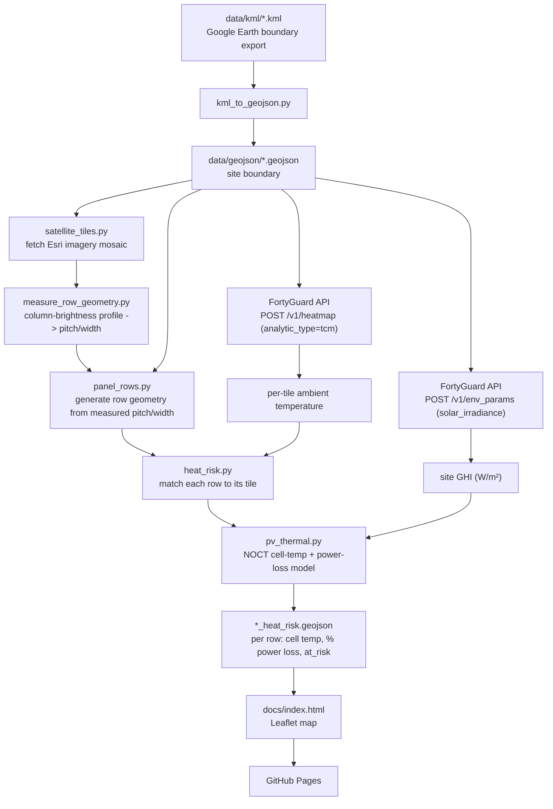

# solar-heat-guard

A FortyGuard hackathon entry: flag which rows of a solar farm are at elevated
heat-damage risk, using [FortyGuard](https://www.fortyguard.com)'s hyperlocal
Temperature API.

**Site:** a utility-scale solar farm at 293 Mendel Rd, Fort Stockton, TX 79735.

## Why

Extended heat exposure accelerates degradation and can push panel surface
temperatures into damaging territory. This project pulls FortyGuard's
per-tile temperature/heat-exceedance data for the site, overlays it against
the array's actual row layout, and flags exactly which rows ran hottest --
turning a site-wide "it's hot today" into a "these specific rows are at
risk" signal.

## How it works



1. **Boundary** -- the site polygon comes from a KML export (Google Earth),
   converted to GeoJSON (`kml_to_geojson.py`).
2. **Panel rows** -- FortyGuard's satellite segmentation has no "solar panel"
   class, so individual rows are approximated ourselves: parallel strips at
   a configurable pitch/width, clipped to the site boundary (`panel_rows.py`).
   Pitch/width come from `measure_row_geometry.py`, which fetches an Esri
   satellite mosaic (`satellite_tiles.py`) and measures the real row spacing
   from a column-brightness profile (see "How panel-row geometry was
   measured" below) -- not eyeballed from a screenshot.
3. **Heatmap** -- one request to FortyGuard's `Create Heatmap` endpoint
   returns a grid of ambient/land-surface temperature tiles across the whole
   site (`tcm`), or hours-above-threshold (`exceedance`/`persistence`).
4. **Irradiance** -- one request to FortyGuard's `Environmental Parameters`
   endpoint returns clear-sky solar irradiance (GHI) for the site.
5. **PV thermal model** -- each panel row's tile temperature + the site's GHI
   feed a standard NOCT cell-temperature model, then a linear temperature
   coefficient gives an estimated % power loss per row (`pv_thermal.py`).
6. **Output + visualization** -- rows are flagged `at_risk` (cell temp at/above
   a configurable max operating temperature) and written to
   `*_heat_risk.geojson`, rendered on a Leaflet map (`docs/index.html`)
   published via GitHub Pages.

## Setup

```bash
python -m venv .venv
./.venv/Scripts/pip install -r requirements.txt   # Windows
# source .venv/bin/activate && pip install -r requirements.txt   # macOS/Linux

cp .env.example .env
# fill in FORTYGUARD_API_KEY
```

## Usage

```bash
# 1. Convert every KML in data/kml/ to GeoJSON
python scripts/kml_to_geojson.py

# 2. (optional, heat_risk.py does this too) preview the approximated panel rows
python scripts/panel_rows.py data/geojson/solar_form_2.geojson

# 3. Run the heat-risk check for a given date (NOCT PV model, default on for tcm)
python scripts/heat_risk.py data/geojson/solar_form_2.geojson \
    --date 2024-07-15 --start-time 14:00 --analytic-type tcm

# ...or the hours-above-threshold view instead of the PV model:
python scripts/heat_risk.py data/geojson/solar_form_2.geojson \
    --date 2024-07-15 --start-time 06:00 --end-time 18:00 \
    --analytic-type exceedance --threshold 35 --direction above --no-pv-model
```

The `tcm` + PV-model run costs 2 FortyGuard requests (one heatmap, one
irradiance); the `exceedance`/`persistence` view costs 1. Either way it
writes `data/geojson/<site>_heat_risk.geojson` -- a FeatureCollection of
panel-row polygons tagged with an `at_risk` flag (plus `cell_temperature_c`
and `power_loss_percent` for the PV model). Load it into any GeoJSON-aware
map viewer (geojson.io, kepler.gl, QGIS, Leaflet), or open `docs/index.html`
/ the [GitHub Pages demo](https://asad-be18.github.io/solar-heat-guard/) to
see risk spatially.

**Picking `--date`:** FortyGuard's data has a processing lag -- very recent
dates (e.g. "yesterday") can return zero tiles even though the request
succeeds. `2024-07-15` is confirmed to return real data; prefer dates that
are safely in the past over "today"/"yesterday".

**Real result on `2024-07-15` at 14:00:** ambient ~35.5°C + GHI ~864 W/m² ->
modeled cell temperature ~61.4°C -> ~13.8% estimated power loss site-wide.
That's a real, concrete "heat is costing you ~14% output right now" number
-- but well below the 85°C absolute max-operating-temp cutoff, so the binary
`at_risk` flag reads 0/152 for this particular hour. The model's headline
value here is the % power loss number, not necessarily the risk flag.

**Picking `--threshold`:** on `2024-07-15` this site's ambient temperature
(`tcm`) peaked around 35.5°C at 14:00, and an `exceedance` check for 40°C
across 06:00-18:00 came back with 0 hours for every row -- a real result,
not a bug, but it means 40°C is too high a bar to show any risk on that
particular day. A threshold closer to the site's actual peak (e.g. 34-35°C)
will show more differentiation for a demo.

## How panel-row geometry was measured

A first attempt tried per-pixel color segmentation (Otsu threshold + connected
components) directly on satellite tiles to vectorize individual row polygons.
That was too noisy to trust: at the zoom level needed (19), row width (~10px)
is close to the imagery's JPEG compression block size, so per-pixel
classification mostly picked up small bright artifacts, not clean rows.

`measure_row_geometry.py` instead averages pixel brightness column-wise
across the whole site (thousands of pixels per column) with
`satellite_tiles.py`'s Esri mosaic fetcher. That averaging cancels out the
per-pixel noise and leaves a clean periodic signal -- one dip per row -- from
which it measures the dominant spatial period (autocorrelation) for pitch,
and the fraction of each period reading darker than its mean (phase-folding)
for width. For this site: **pitch 5.38 m, width 2.82 m**, replacing the
originally eyeballed 6 m / 2.5 m. Orientation (north-south) is 0 deg by
construction of the north-up mosaic, not something this script re-derives.

This is still a site-wide average, not a per-row survey -- real row lines can
still drift from these numbers locally. Re-run it if the boundary or site
changes: `python scripts/measure_row_geometry.py data/geojson/solar_form_2.geojson`.

## Known limitations (be upfront about these in the demo)

- **Panel rows are a measured average, not a per-row survey.** See above --
  pitch/width are measured from real imagery, but individual rows can still
  deviate from that average locally.
- **PV model constants are typical values, not this site's real spec.**
  NOCT (44°C), temperature coefficient (-0.38%/°C), and the max operating
  temperature cutoff (85°C) are standard utility-scale c-Si module figures,
  overridable via `--noct`/`--temp-coeff`/`--max-operating-temp`. Swap in
  real panel datasheet numbers if available.
- **Irradiance is a clear-sky model, not a cloud-adjusted measurement.**
  FortyGuard's `env_params` `solar_irradiance` is explicitly documented as
  clear-sky GHI/DNI/DHI, and is queried once at the site centroid and
  applied uniformly across all rows (reasonable at ~1km scale, since
  irradiance doesn't vary much over that distance).
- **FortyGuard's satellite segmentation has no "solar panel" class**
  (confirmed directly), which is why this project overlays heatmap tiles
  onto approximated geometry instead of using their segmentation endpoint.
- **API quota:** the FortyGuard account used here is capped at 30 heatmap
  requests/day. Each `heat_risk.py` run costs exactly one.

## Project layout

```
data/kml/            KML site boundaries (Google Earth exports)
data/geojson/         Converted boundaries + generated panel rows + risk output
docs/                 Leaflet visualization, published via GitHub Pages
scripts/
  kml_to_geojson.py   KML -> GeoJSON boundary conversion
  geo_utils.py        Local lon/lat <-> meters projection (site-scale accuracy)
  satellite_tiles.py  Esri World Imagery tile fetch/stitch + pixel<->lonlat math
  measure_row_geometry.py  Measures real row pitch/width from a satellite mosaic
  panel_rows.py       Approximate panel-row geometry generator
  fortyguard_client.py FortyGuard API client (heatmap, env_params, status polling)
  pv_thermal.py       NOCT cell-temperature + power-loss model
  heat_risk.py        End-to-end pipeline: heatmap + irradiance -> rows -> risk
```
