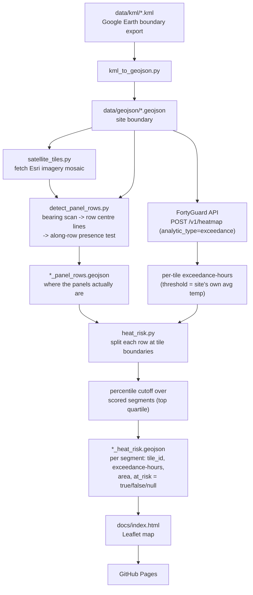

# solar-heat-guard

A FortyGuard hackathon entry: a **ranked heat-exposure map** for a solar
farm, using [FortyGuard](https://www.fortyguard.com)'s hyperlocal Temperature
API to answer not "where is it hot?" but **"where should the operator look
first?"**

**Site:** a utility-scale solar farm at 293 Mendel Rd, Fort Stockton, TX 79735.

## Why

Utility-scale solar farms are large enough that operators can't tell, from a
single site-wide reading, where heat exposure is unusually high and
persistent -- making it hard to prioritize limited inspection, sensor, and
maintenance resources (see issue #2 for the full business case). Rather than
assuming an absolute "damage" temperature (which is hard to pin down and
easy to get wrong), this project asks a site-relative question instead:
**which zones of this array consistently run hotter than the rest of the
site?** It pulls FortyGuard's per-tile exceedance-hours data, overlays it on
the array's *actual* row layout as detected from satellite imagery, and ranks
each stretch of each row against this site's own baseline -- flagging the top
quartile as hotspots an operator could prioritize for inspection, rather than
a site-wide "it's hot today." The same signal is a foundation for a broader
risk system later, combining heat exposure with SCADA/equipment/maintenance
data to confirm whether a hotspot maps to an actual operational issue.

Nothing here estimates panel temperature or power loss: answering "which
areas run hotter than the rest" doesn't require it, and doing it well would
require this site's real module spec. (An earlier direction did model cell
temperature and % power loss via NOCT; it was dropped -- see issue #1.)

## How it works



1. **Boundary** -- the site polygon comes from a KML export (Google Earth),
   converted to GeoJSON (`kml_to_geojson.py`). It is a hand-drawn outline, so
   it contains bare ground as well as panels; step 2 is what tells them apart.
2. **Panel rows** -- FortyGuard's satellite segmentation has no "solar panel"
   class, so row geometry is detected from Esri satellite imagery
   (`detect_panel_rows.py` over `satellite_tiles.py`): the row **bearing** is
   found by scanning angles for maximum profile contrast, row **centre lines**
   are read off that profile directly, and each row is then walked end to end
   and kept only where the imagery under it is actually dark. See "How panel
   rows are detected" below.
3. **Heatmap** -- one request to FortyGuard's `Create Heatmap` endpoint,
   `analytic_type=exceedance`, with `--threshold` set to the site's own
   measured average temperature -- turning "hours above threshold" into
   "hours running hotter than this site's own typical temperature."
4. **Split at tile boundaries** -- each detected row is cut where it crosses
   a heatmap tile edge, so every scored unit lies inside exactly one tile and
   carries the measurement that actually covers it. Rows here run up to
   ~330 m against 60 m tiles, so this matters (see "Resolution" below).
5. **Site-relative hotspot cutoff** -- rather than any fixed absolute number,
   a segment is flagged when its exceedance-hours sit in the top
   `--risk-percentile` (default 75th) of **this site's own scored segments**.
   Segments are near-uniform in area, so this is close to ranking by panel
   area. Segments with no covering tile are excluded from the percentile.
6. **Output + visualization** -- segments are written to
   `*_heat_risk.geojson` with a `tile_id`, an `area_m2`, and a three-state
   `at_risk` flag (`true` / `false` / `null` for "no covering tile"), rendered
   on a Leaflet map (`docs/index.html`) published via GitHub Pages.

## Setup

```bash
python -m venv .venv
./.venv/Scripts/pip install -r requirements.txt   # Windows
# source .venv/bin/activate && pip install -r requirements.txt   # macOS/Linux

cp .env.example .env
# fill in FORTYGUARD_API_KEY
```

Dependencies are pinned. For the test suite:

```bash
./.venv/Scripts/pip install -r requirements-dev.txt
./.venv/Scripts/python -m pytest tests/ -q     # 60 tests, fully offline
```

## Usage

```bash
# 1. Convert every KML in data/kml/ to GeoJSON
python scripts/kml_to_geojson.py

# 2. Detect the panel rows from satellite imagery (no FortyGuard quota;
#    imagery tiles are cached on disk). --overlay renders the detection over
#    the imagery so you can check the fit by eye.
python scripts/detect_panel_rows.py data/geojson/solar_farm_1.geojson \
    --overlay /tmp/rows.png

# 3. Rank heat exposure for a given date
python scripts/heat_risk.py data/geojson/solar_farm_1.geojson \
    --date 2024-07-15 --start-time 06:00 --end-time 18:00 --granularity 60

# 4. Bundle every site that has a result into the Leaflet map
python scripts/build_viz_data.py
```

Step 2 is run explicitly and its output is committed, so steps 3-4 and the
test suite never need imagery or the network. Re-run it if the boundary
changes or the imagery is refreshed.

Step 3 costs 1 FortyGuard request and writes
`data/geojson/<site>_heat_risk.geojson` -- a FeatureCollection of row-segment
polygons, each tagged with the `tile_id` it was scored from, its panel area,
and a three-state `at_risk` flag. Load it into any GeoJSON-aware map viewer
(geojson.io, kepler.gl, QGIS, Leaflet), or open `docs/index.html` / the
[GitHub Pages demo](https://asad-be18.github.io/solar-heat-guard/) to see it
spatially.

**`at_risk` is three-state, on purpose.** `true` = flagged, `false` = measured
and cleared, `null` = no heatmap tile covers this stretch, so it is *unknown*
-- never folded in with the cleared segments. Summary counts use a
scored-segments denominator, so ground that could not be evaluated cannot
dilute the at-risk rate. The map paints unknown segments grey with their own
legend entry.

**AOI buffering (`--aoi-buffer`, default 600 m):** FortyGuard returns whole
cells of its own grid and drops the ones the AOI only partly covers, so the
returned mosaic can stop short of the boundary that was asked for -- on the
unbuffered `2024-07-15` run it stopped up to 147 m inside the south edge and
left 9.4% of the site (6.4 ha) with no covering tile, scored `at_risk=null`.
The request polygon is therefore grown by a whole number of tiles so that
shortfall falls outside the real site. Scoring is unchanged: segments still
come from the unbuffered site's detected rows, and the extra tiles contain no
rows, so they never enter the percentile basis. The cost is a bigger request
-- 600 m turns this 67.7 ha site into a 431 ha AOI, and FortyGuard returned
1,040 tiles for it instead of 176. It closed the gap completely: **zero**
unknown segments, against 173 before. `--aoi-buffer 180` would cover the
146.8 m shortfall measured here for roughly a third of the tiles.

**Completed API results are cached** under `data/fortyguard/_response_cache/`,
keyed by request payload, so re-running the pipeline with the same parameters
costs no quota -- useful when iterating on the detection, the percentile, or
the visualization. Pass `--no-cache` to force a live request. The API key is
never part of the cache key and is never written to disk.

**Picking `--date`:** FortyGuard's data has a processing lag -- very recent
dates (e.g. "yesterday") can return zero tiles even though the request
succeeds. `2024-07-15` is confirmed to return real data; prefer dates that
are safely in the past over "today"/"yesterday".

**`--threshold` is measured, not chosen.** It defaults to `auto`: the run
spends one extra `tcm` request on the same AOI and window, and takes the mean
of the covering tiles' **peak** (`max_temperature`) as the threshold. So no
result carries a hand-picked number, and "exceedance" means "hours this spot
ran hotter than this site's own typical daily peak."

Calibrate on the peak, never the window mean. Exceedance counts hours above
the threshold, so the threshold has to sit where the diurnal curve is flat for
a small spatial temperature difference to move the crossing time at all.
Measured on farm 4, `2025-07-15`: the window mean (29.09°C) sits on the
morning ramp, where the 0.07°C of spatial spread shifts the crossing by
seconds -- every tile returned **exactly 7.00 hours**, a perfectly flat map.
The mean of the tiles' own peaks (34.18°C) returned -0.10 to 0.40 and split
the site cleanly.

Negative values are not a bug: FortyGuard interpolates the diurnal curve, so a
tile whose peak never reaches the threshold reports how far short it fell
rather than clamping to zero. Calibrating at the site's median peak puts
roughly half the site on each side, which is what makes the ranking
discriminate.

**A run whose scored values are all identical is refused, not published.** A
percentile of a constant field is that same constant, and every segment then
clears it -- "100% of this farm is a hotspot" is not a finding, it is a
degenerate comparison. That check is what caught the 7.00-hours calibration
above, and the `2026-07-15` probe before it.

**Real result: five farms on `2025-07-15`, 06:00-18:00, granularity 60 m,
`--aoi-buffer 600`, threshold auto-calibrated per site.**

| farm | rows | threshold | tiles returned | tiles with rows | segments | flagged | hotspot area |
|---|---|---|---|---|---|---|---|
| 1 | N-S | 34.46 C | 1,040 | 213 | 2,952 | 750 | 7.14 / 27.78 ha |
| 2 | N-S | 34.54 C | 1,330 | 319 | 4,680 | 1,178 | 11.64 / 46.52 ha |
| 3 | E-W | 34.17 C | 1,022 | 205 | 2,446 | 622 | 9.91 / 45.32 ha |
| 4 | E-W | 34.18 C | 727 | 56 | 622 | 163 | 3.62 / 12.85 ha |
| 5 | N-S | -- | 948 | 81 | -- | **refused** | flat field, see limitations |
| 6 | N-S | 34.38 C | 2,390 | 636 | 9,335 | 2,356 | 23.20 / 90.89 ha |

**20,035 row-in-tile segments across the five resolved farms, 5,069 flagged as
hotspots, 55.51 ha of 223.36 ha of scored panel area -- and zero segments
without data on any of them.** The AOI buffer holds across every site: before
it, farm 1 alone lost 9.4% of its area to uncovered ground.

Farm 5 is not a gap in the pipeline, it is the pipeline refusing to publish:
every tile under it came back with the same value, so there was nothing to
rank. See "Known limitations" -- and read the date-stability entry there
before presenting any of these numbers as an operational output.

## How panel rows are detected

FortyGuard's segmentation has no "solar panel" class, so the geometry is
derived from Esri World Imagery. Panels read dark against bare desert soil:
inside this boundary the brightness histogram is strongly bimodal, a panel
mode near 64 and a soil mode near 215, with a wide flat valley between them.
Everything below hangs off that separation.

**1. Bearing.** Candidate angles are scanned; for each, the panel mask is
sheared so rows would lie at constant across-row position, and the resulting
profile is scored by `p90 - p10` of its dark fraction. At the right angle a
row line reads 94% dark and a gap 2%; at a wrong one both smear together.

Both orientations are scanned, because rows do not all run north-south: in
this cluster farms 1, 2, 5 and 6 do, while **farms 3 and 4 run east-west**.
The shear is by `tan(bearing)`, which blows up toward 90 deg, so east-west is
reached by scanning the transposed mask rather than by widening the angle
limit; whichever gives the higher contrast wins. It is not a close call --
0.92 against 0.20 on farm 3, 0.97 against 0.15 on farm 4. Fitted at the wrong
orientation, farm 3 came back as 3 "rows" 397 m apart and 123 m wide -- its
400 m block structure -- and claimed 88.3% panel coverage against a 72.8%
imagery dark fraction.

**2. Pitch, width, centre lines.** At the chosen bearing, the profile's dark
runs *are* the rows. Their centres and widths are read off directly rather
than fitted to a lattice, so a missing or irregularly spaced row is
represented as it actually is. Pitch is reported as the median centre-to-centre
spacing, and nothing downstream extrapolates from it.

**3. Along-row presence.** Each row is walked end to end in ~5 m bins, and a
bin is kept only where the imagery under it is actually dark. This is what
stops rows at the gaps between panel blocks, at access roads, and at the edge
of the array — rather than at the drawn boundary.

For this site: **bearing -1.51°, pitch 5.63 m, width 2.56 m, 135 row lines,
1,244 contiguous runs covering 27.90 ha (41.2% of the site).** 1,766 of 22,711
along-row bins were rejected as bare ground or block gap. The imagery's own
dark fraction inside the boundary is 43.9%, so the detected panel area lands
just under it — the right side to err on, since some dark pixels are shadow
and scrub rather than panel.

`--overlay` renders the detection over the imagery. All three of the bugs
described below were found by looking at that overlay, not in the numbers, so
it is worth looking at whenever the site or imagery changes.

### What this replaced, and why

The previous implementation measured a pitch from a column-brightness profile
and extrapolated a uniform lattice of strips across the whole site polygon. It
had three faults, which compounded:

- **It assumed rows run exactly north-south**, on the reasoning that rows
  "appear vertical in a north-up Web Mercator mosaic." Row bearing is a
  property of the site's layout, not of the projection. These rows run 1.51°
  off grid north, so a vertical strip crossed a real row about every half
  pitch and the generated strips sat in the *bare gaps between* rows.
- **Pitch, width and phase were therefore all fitted to a smeared signal.**
  Integrating a tilted pattern along vertical lines washes out the
  periodicity, biasing pitch low and width high (5.38 m / 2.82 m against
  5.63 m / 2.56 m once the tilt is removed). The smear also showed as a weak
  0.34 autocorrelation, which was recorded and not treated as the warning it
  was.
- **The lattice covered the entire polygon.** Bare ground inside a hand-drawn
  boundary — margins, access roads, the gaps between blocks — was labelled as
  panel. It claimed 52.4% panel coverage against the imagery's 43.9%,
  overstating panel area by about a quarter.

Measured at the corrected bearing versus the assumed one, on this site:

| | 0° (assumed) | -1.51° (measured) |
|---|---|---|
| along-row dark fraction, row vs gap | 0.39 vs 0.49 | **0.02 vs 0.94** |
| profile contrast (`p90 - p10`) | 0.10 | **0.92** |
| pitch autocorrelation | 0.34 | **0.94** |

A 9× contrast gap is what makes the bearing estimate unambiguous, and it is
the check that the north-south assumption would have failed had anyone run it.

An even earlier attempt tried per-pixel colour segmentation (Otsu + connected
components) to vectorize row polygons directly. That was too noisy: at zoom
19 a row is ~10 px wide, close to the imagery's JPEG block size, so per-pixel
classification mostly picked up compression artifacts. Exploiting the layout's
regularity — one bearing, one profile, per-row presence — is what makes the
signal clean.

## Resolution: rows are finer than the data behind them

Rows sit 5.63 m apart; FortyGuard's finest heatmap granularity is 60 m. Each
scored segment is one panel row where it crosses one tile, so it carries that
tile's own measurement — but about eleven rows cross any given tile, so
**neighbouring rows inside one tile still share a value**. The map is honest
about this on its own face: per-row polygons, tile-resolution measurements
across the site.

What splitting at tile boundaries fixes is the *along*-row direction. An
earlier version assigned each row the value of the single tile its centroid
landed in. Because rows were also full-site-length strips (median 861 m), that
put every centroid in a narrow band across the middle of the site:

| | centroid lookup | split at tile edges |
|---|---|---|
| tiles used | **21 of 176** | **176 of 176** |
| value range seen | 2.51-2.98 h | **1.98-3.11 h** |
| top-quartile cutoff | 2.72 h | 2.98 h |

154 of the 176 tiles FortyGuard returned were discarded, and the site's
genuine hottest and coolest ground was in tiles no centroid touched — so the
map could not show either. The percentile basis changed with it: it is now
taken over row-in-tile segments, which are near-uniform in area, making it
close to a panel-area weighting. Every label states the basis in use, because
a tile-weighted cutoff still differs.

## Known limitations (be upfront about these in the demo)

- **Row geometry is detected from imagery, not surveyed.** Bearing, pitch,
  width, and extent all come from Esri World Imagery at 0.256 m/px. Good
  enough to place rows on the right ground; not a substitute for an as-built
  layout, and it inherits whatever date the imagery was captured.
- **Panel presence is a brightness test.** A panel is "dark ground in a
  periodic row pattern." Anything dark and row-shaped would qualify, and a
  panel obscured by dust, glare, or cloud shadow could be missed. The
  detected 41.2% area against the imagery's 43.9% dark fraction is the
  headline sanity check; `--overlay` is the real one.
- **Row resolution exceeds data resolution across the site.** 5.63 m rows,
  60 m tiles; see "Resolution" above. Splitting at tile edges fixes the
  along-row direction, not the across-row one.
- **Some segments have no data.** Segments covered by no returned tile are
  reported `at_risk: null` and rendered grey -- unknown, not cleared. They are
  excluded from the percentile and from the at-risk denominator.
- **The date-to-date behaviour of the metric is not understood, and the two
  sites tested disagree with each other.** Both were run on `2024-07-15` and
  `2025-07-15`, same window, same auto-calibration:

  | | farm 1 | farm 3 |
  |---|---|---|
  | difference between the two dates | **exactly 2.000000 h everywhere** (std 0.00000000, 1 distinct value over 213 tiles) | varies: -0.10 to +1.33, std 0.359, 202 distinct values |
  | rank correlation | **+1.0000** | **-0.7560** |
  | flagged segments in common | all 750 (identical set) | **0 of ~620** |

  Farm 1 behaves as one spatial layer with a constant level shift -- two
  independent days of weather cannot differ with zero variance to six decimal
  places. Farm 3 behaves as though the pattern *inverted* between the two
  dates. Both cannot be right, so **treat the day-to-day ranking as
  unvalidated**: it is reproducible for a given date, but which rows it flags
  is not stable across dates in a way we can currently explain, and on farm 3
  it is not stable at all. What would settle it: a third date per site, and a
  direct check of whether FortyGuard's `value` field for `exceedance` means
  the same thing on both sides of the threshold (negative values are returned
  when a tile never reaches it). Neither has been done.

  This is the single biggest open question in the project. Do not present the
  per-date map as a validated operational output until it is resolved.
- **One site in this cluster could not be resolved at all.** Farm 5's tiles
  came back with a single distinct value across the whole site, so there was
  nothing to rank and the run was **refused** rather than published. That is
  the degenerate-field check doing its job; the alternative would have been a
  map flagging 100% of the farm as a hotspot.
- **The hotspot cutoff reflects one day, not sustained recurrence.** "Runs
  consistently hotter" implies persistence across multiple days; the current
  demo uses a single representative day (FortyGuard's 30 heatmap
  requests/day cap makes multi-day aggregation proportionally more
  expensive). See issue #1 for the open question of whether that's enough
  for the demo or worth the extra spend.
- **FortyGuard's satellite segmentation has no "solar panel" class**
  (confirmed directly), which is why this project detects row geometry from
  third-party imagery instead of using their segmentation endpoint.
- **API quota:** the FortyGuard account used here is capped at 30 heatmap
  requests/day. Each `heat_risk.py` run costs one request -- unless it is
  served from the on-disk result cache, which makes repeat runs of an
  identical request free. `detect_panel_rows.py` costs none.

## Project layout

```
data/kml/             KML site boundaries (Google Earth exports)
data/geojson/         Converted boundaries + detected panel rows + risk output
data/fortyguard/      Cached Esri imagery tiles + cached API results (gitignored)
docs/                 Leaflet visualization, published via GitHub Pages
tests/                Offline regression tests (pytest; no API calls, no imagery)
scripts/
  kml_to_geojson.py   KML -> GeoJSON boundary conversion
  geo_utils.py        Local lon/lat <-> meters projection (site-scale accuracy)
  satellite_tiles.py  Esri World Imagery tile fetch/stitch + pixel<->lonlat math
  detect_panel_rows.py  Detects row bearing, pitch, width and extent from imagery
  fortyguard_client.py FortyGuard API client (heatmap, polling, result caching,
                      429/5xx retry with backoff)
  heat_risk.py        End-to-end: heatmap + detected rows -> ranked segments
  build_viz_data.py   Bundles each site into docs/site_<id>.js + docs/sites.js
```
