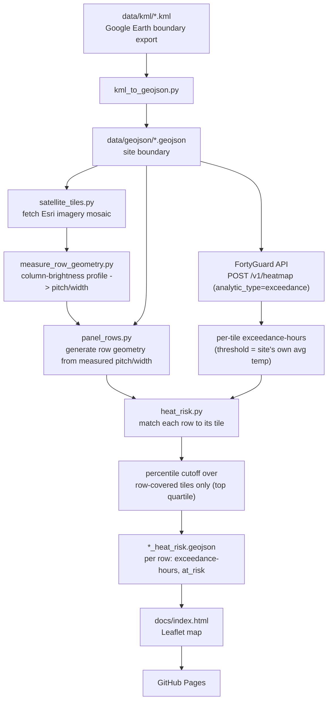

# solar-heat-guard

A FortyGuard hackathon entry: flag which rows of a solar farm are at elevated
heat-damage risk, using [FortyGuard](https://www.fortyguard.com)'s hyperlocal
Temperature API.

**Site:** a utility-scale solar farm at 293 Mendel Rd, Fort Stockton, TX 79735.

## Why

Extended heat exposure accelerates degradation. Rather than assuming an
absolute "damage" temperature (which is hard to pin down and easy to get
wrong), this project asks a site-relative question instead: **which zones of
this array consistently run hotter than the rest of the site?** It pulls
FortyGuard's per-tile temperature/exceedance-hours data, overlays it against
the array's actual row layout, and flags rows in the top quartile of this
site's own tiles -- a self-calibrating hotspot signal an operator could use
to prioritize inspections, rather than a site-wide "it's hot today."

(An earlier direction estimated actual panel cell temperature and % power
loss via a NOCT thermal model -- see `--pv-model` below. Still available,
but not the primary framing; see issue #1 for the discussion.)

## How it works



1. **Boundary** -- the site polygon comes from a KML export (Google Earth),
   converted to GeoJSON (`kml_to_geojson.py`).
2. **Panel rows** -- FortyGuard's satellite segmentation has no "solar panel"
   class, so individual rows are approximated ourselves: parallel strips at
   a configurable pitch/width, clipped to the site boundary (`panel_rows.py`).
   Pitch/width come from `measure_row_geometry.py`, which fetches an Esri
   satellite mosaic (`satellite_tiles.py`) and measures the real row spacing
   from a column-brightness profile (see "How panel-row geometry was
   measured" below) -- not eyeballed from a screenshot.
3. **Heatmap** -- one request to FortyGuard's `Create Heatmap` endpoint,
   `analytic_type=exceedance`, with `--threshold` set to the site's own
   measured average temperature -- turning "hours above threshold" into
   "hours running hotter than this site's own typical temperature."
4. **Site-relative hotspot cutoff** -- rather than any fixed absolute number,
   a row is flagged when its tile's exceedance-hours sit in the top
   `--risk-percentile` (default 75th) of tiles that actually contain panel
   rows -- not all of this site's tiles, since edge/gap tiles with no rows
   in them would skew the cutoff.
5. **Output + visualization** -- rows are written to `*_heat_risk.geojson`
   with an `at_risk` flag, rendered on a Leaflet map (`docs/index.html`)
   published via GitHub Pages.

An alternative mode (`--pv-model`, needs `--analytic-type tcm`) estimates
actual panel cell temperature and % power loss via a NOCT thermal model
(`pv_thermal.py`) fed by FortyGuard's `Environmental Parameters` endpoint for
irradiance -- a real "% output lost to heat" number, but not needed for the
hotspot framing above. See "Known limitations" for both modes' caveats.

## Setup

```bash
python -m venv .venv
./.venv/Scripts/pip install -r requirements.txt   # Windows
# source .venv/bin/activate && pip install -r requirements.txt   # macOS/Linux

cp .env.example .env
# fill in FORTYGUARD_API_KEY
```

## Usage

```bash
# 1. Convert every KML in data/kml/ to GeoJSON
python scripts/kml_to_geojson.py

# 2. (optional, heat_risk.py does this too) preview the approximated panel rows
python scripts/panel_rows.py data/geojson/solar_form_2.geojson

# 3. Run the hotspot check for a given date (site-relative, default mode)
python scripts/heat_risk.py data/geojson/solar_form_2.geojson \
    --date 2024-07-15 --start-time 06:00 --end-time 18:00 --granularity 60

# ...or the NOCT PV thermal model instead (real cell-temp/% power-loss estimate):
python scripts/heat_risk.py data/geojson/solar_form_2.geojson \
    --date 2024-07-15 --start-time 14:00 --analytic-type tcm --pv-model
```

The default hotspot mode costs 1 FortyGuard request; `--pv-model` costs 2
(heatmap + irradiance). Either way it writes
`data/geojson/<site>_heat_risk.geojson` -- a FeatureCollection of panel-row
polygons tagged with an `at_risk` flag (plus `cell_temperature_c` and
`power_loss_percent` for the PV model). Load it into any GeoJSON-aware map
viewer (geojson.io, kepler.gl, QGIS, Leaflet), or open `docs/index.html` /
the [GitHub Pages demo](https://asad-be18.github.io/solar-heat-guard/) to see
it spatially.

**Picking `--date`:** FortyGuard's data has a processing lag -- very recent
dates (e.g. "yesterday") can return zero tiles even though the request
succeeds. `2024-07-15` is confirmed to return real data; prefer dates that
are safely in the past over "today"/"yesterday".

**Picking `--threshold` (hotspot mode):** set it to the site's own measured
average temperature for the window, not an arbitrary number -- e.g. on
`2024-07-15` this site's ambient temperature (`tcm`) measured ~35.5°C at
14:00, so `--threshold 35.5` turns "exceedance" into "hours running hotter
than this site's own typical temperature." A too-high threshold (we tried
40°C) returns 0 hours for every tile -- a real result, not a bug, but not
useful for hotspot detection.

**Real result on `2024-07-15`, 06:00-18:00, granularity 60m:** tile
exceedance-hours (above 35.5°C) ranged 1.98-3.11 across 176 tiles;
restricting to the 152 tiles that actually contain panel rows, the range was
2.51-3.03 and the top-quartile cutoff was 2.72 hours -- **47/152 rows (31%)
flagged as recurring hotspots.**

**Real result with `--pv-model` on `2024-07-15` at 14:00:** ambient ~35.5°C +
GHI ~864 W/m² -> modeled cell temperature ~61.4°C -> ~13.8% estimated power
loss site-wide -- a real, concrete "heat is costing ~14% output right now"
number, but well below the 85°C absolute max-operating-temp cutoff (0/152
rows flagged). The model's headline value here is the % power-loss number,
not the risk flag.

## How panel-row geometry was measured

A first attempt tried per-pixel color segmentation (Otsu threshold + connected
components) directly on satellite tiles to vectorize individual row polygons.
That was too noisy to trust: at the zoom level needed (19), row width (~10px)
is close to the imagery's JPEG compression block size, so per-pixel
classification mostly picked up small bright artifacts, not clean rows.

`measure_row_geometry.py` instead averages pixel brightness column-wise
across the whole site (thousands of pixels per column) with
`satellite_tiles.py`'s Esri mosaic fetcher. That averaging cancels out the
per-pixel noise and leaves a clean periodic signal -- one dip per row -- from
which it measures the dominant spatial period (autocorrelation) for pitch,
and the fraction of each period reading darker than its mean (phase-folding)
for width. For this site: **pitch 5.38 m, width 2.82 m**, replacing the
originally eyeballed 6 m / 2.5 m. Orientation (north-south) is 0 deg by
construction of the north-up mosaic, not something this script re-derives.

This is still a site-wide average, not a per-row survey -- real row lines can
still drift from these numbers locally. Re-run it if the boundary or site
changes: `python scripts/measure_row_geometry.py data/geojson/solar_form_2.geojson`.

## Known limitations (be upfront about these in the demo)

- **Panel rows are a measured average, not a per-row survey.** See above --
  pitch/width are measured from real imagery, but individual rows can still
  deviate from that average locally.
- **The hotspot cutoff reflects one day, not sustained recurrence.** "Runs
  consistently hotter" implies persistence across multiple days; the current
  demo uses a single representative day (FortyGuard's 30 heatmap
  requests/day cap makes multi-day aggregation proportionally more
  expensive). See issue #1 for the open question of whether that's enough
  for the demo or worth the extra spend.
- **PV model constants are typical values, not this site's real spec.**
  (Only relevant with `--pv-model`.) NOCT (44°C), temperature coefficient
  (-0.38%/°C), and the max operating temperature cutoff (85°C) are standard
  utility-scale c-Si module figures, overridable via
  `--noct`/`--temp-coeff`/`--max-operating-temp`. Swap in real panel
  datasheet numbers if available.
- **Irradiance is a clear-sky model, not a cloud-adjusted measurement.**
  (Only relevant with `--pv-model`.) FortyGuard's `env_params`
  `solar_irradiance` is explicitly documented as clear-sky GHI/DNI/DHI, and
  is queried once at the site centroid and applied uniformly across all rows
  (reasonable at ~1km scale, since irradiance doesn't vary much over that
  distance).
- **FortyGuard's satellite segmentation has no "solar panel" class**
  (confirmed directly), which is why this project overlays heatmap tiles
  onto approximated geometry instead of using their segmentation endpoint.
- **API quota:** the FortyGuard account used here is capped at 30 heatmap
  requests/day. Each `heat_risk.py` run costs one request (two with
  `--pv-model`, for the extra irradiance call).

## Project layout

```
data/kml/            KML site boundaries (Google Earth exports)
data/geojson/         Converted boundaries + generated panel rows + risk output
docs/                 Leaflet visualization, published via GitHub Pages
scripts/
  kml_to_geojson.py   KML -> GeoJSON boundary conversion
  geo_utils.py        Local lon/lat <-> meters projection (site-scale accuracy)
  satellite_tiles.py  Esri World Imagery tile fetch/stitch + pixel<->lonlat math
  measure_row_geometry.py  Measures real row pitch/width from a satellite mosaic
  panel_rows.py       Approximate panel-row geometry generator
  fortyguard_client.py FortyGuard API client (heatmap, env_params, status polling)
  pv_thermal.py       NOCT cell-temperature + power-loss model
  heat_risk.py        End-to-end pipeline: heatmap + irradiance -> rows -> risk
```
